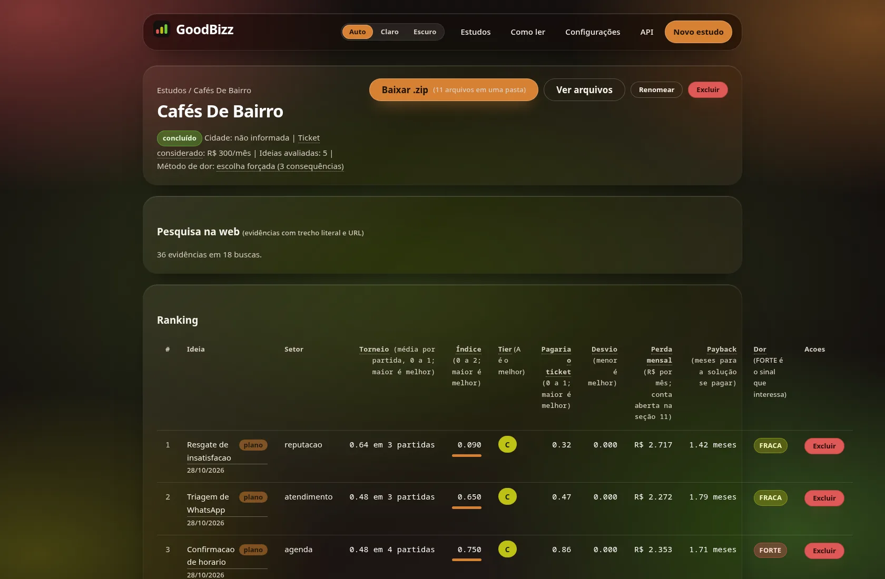

# GoodBizz

[](https://github.com/passoz/goodbizz/actions/workflows/ci.yml)
[](LICENSE)
[](https://bun.sh)

Gerador de estudos de negócio para nichos locais. Você informa um nicho curto e o serviço pesquisa a
web, propõe ideias de produto, mede cada uma com um decisor probabilístico e escreve um plano
executivo com estratégia, preço, riscos, payback e roadmap.

O mesmo núcleo atende três superfícies: CLI, API HTTP e interface web renderizada no servidor.



## O que faz

- **Pesquisa antes de escrever.** Gera de 6 a 10 buscas sobre o nicho e guarda afirmação, trecho
  literal e URL. Trecho que não aparece no conteúdo é descartado.
- **Mede em vez de opinar.** Cada ideia passa pelo decisor System One: `fit`, `venda`, `disrupção`,
  dor, suporte solo, disposição a pagar e meta de 30 clientes.
- **Ordena por duelo.** Depois da nota absoluta, um torneio suíço par a par decide o ranking, com
  viés de posição anulado.
- **Guardrail numérico.** Todo valor em reais, percentual e prazo precisa existir nos dados medidos,
  nas evidências ou estar marcado `[INFERENCE]`. O LLM escreve a prosa; o código calcula os números.
- **Artefatos completos.** Markdown, CSV, JSON, HTML e PDF por estudo, com cache por estudo e
  retomada do ponto onde parou.

## Como rodar

Requisito: [Bun](https://bun.sh) 1.4 ou superior.

```bash
bun install

# pipeline completo, offline e determinístico
bun run cli generate "cafés de bairro" --ideas 3 --mock

# interface web em http://localhost:3000
GOODBIZZ_MOCK=1 bun run start
```

Para usar provedores reais, copie `.env.example` para `.env` e preencha as chaves. O processo falha
no startup se `APP_ENV=production` e `SESSION_SECRET` continuar com o valor de desenvolvimento.

## Arquitetura

```text
src/
  domain/           tipos, portas e erros puros; não importa application nem infrastructure
  application/      casos de uso e pipeline do estudo
  infrastructure/   Hono, Drizzle/SQLite, clientes HTTP de LLM, decisor e busca
  config/           ambiente validado com Zod e redação de segredos
  cli.ts            CLI
  index.ts          bootstrap do serviço
tests/              604 testes, suíte offline e determinística
legacy/python/      implementação original em Python, mantida como referência
docs/manual.md      manual completo (API, UI, metodologia, operação)
```

Regra de dependência: `domain` não conhece as camadas externas. Acesso a dados passa por Drizzle
sobre SQLite; nenhum caso de uso escreve SQL cru. CLI, API e UI chamam o mesmo `StudyService`.

## Stack

Bun 1.4, TypeScript estrito, Hono com JSX no servidor, Drizzle ORM, SQLite, Zod, Pino e Tinybench.
Testes com `bun test`; qualidade com ESLint, Prettier e `tsc --noEmit`. CI em quatro jobs: qualidade,
testes com cobertura, segurança (`bun audit` e Gitleaks) e build da imagem com smoke em `/healthz`.

## Desenvolvimento

```bash
bun run check          # tsc --noEmit
bunx eslint .          # lint
bun test --coverage    # testes + gate de cobertura
bun run dev            # serviço com watch
```

O manual completo — rotas da API, telas, configuração em runtime, metodologia e operação — está em
[`docs/manual.md`](docs/manual.md).

## Segurança

O serviço não tem autenticação multiusuário. Use atrás de um proxy autenticado se expuser a API.
Nunca coloque dado pessoal ou segredo comercial no campo de nicho: o texto vai para os provedores
configurados. Para reportar uma vulnerabilidade, veja [`SECURITY.md`](SECURITY.md).

## Licença

MIT. Veja [`LICENSE`](LICENSE).
